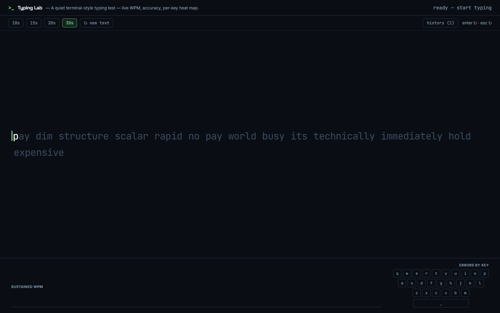

# Typing Lab

A quiet, terminal-style typing test — live WPM, accuracy, and a per-key error
heat map. No accounts, no network, no sound. Just you and the clock.

- **Live:** `https://devdonner.github.io/typing-lab/`
- **Source:** https://github.com/DevDonner/typing-lab



## What it does

- **Type to start.** No start button — your first character starts the clock.
  `Enter` or `Esc` restarts with fresh text.
- **Live readout at 10 Hz:** remaining time, net WPM, accuracy — mirrored to a
  screen-reader `aria-live` region.
- **Caret semantics:** untyped chars are dim, the current char is bright,
  typed-correct is phosphor green, typed-error is red with a wash. Backspace
  retreats the caret and un-marks the display — but never un-counts an error.
- **End card:** net WPM, raw WPM, accuracy, consistency, chars, personal best,
  NEW BEST badge, retry, and a **share link** (the `?seed=` makes the text
  identical for everyone).
- **Sustained WPM sparkline** — per-second samples on a canvas, pauses show
  up as flat lines.
- **Per-key error heat map** (QWERTY + space) on desktop, "most mistyped"
  chips on mobile.
- **Local history** — last 50 runs in `localStorage`, best/average in a
  drawer, one tap to clear. Nothing leaves the browser.

## Run it

```sh
npm install
npm run dev        # http://localhost:4181/typing-lab/  (base matches Pages)
npm test           # node --test over the pure engine (40 tests)
npm run build      # tsc --noEmit && vite build
```

## Architecture

`DESIGN.md` is the design doc; this is the tour.

```
src/lab/
├── engine/          pure TS — no DOM, no React, clock-injected, unit-tested
│   ├── rng.ts        mulberry32 + randomSeed()
│   ├── words.ts      ~450-word pool; dedup + length cap enforced structurally
│   ├── sample.ts     seeded text sampler (no adjacent repeats)
│   ├── typing.ts     state machine: createTest / applyKey / tick
│   ├── stats.ts      wpm / raw / accuracy / consistency
│   ├── history.ts    RunRecord + pure list ops (cap 50)
│   ├── storage.ts    thin localStorage adapter (all access try/catch)
│   └── urlState.ts   ?time=..&seed=.. parse/build
├── ui/
│   ├── WordStream.tsx    sliding window, per-char styling, caret
│   ├── Sparkline.tsx     DPR-aware canvas sparkline
│   ├── Heatmap.tsx       QWERTY error heat map + mobile chips
│   ├── ResultsPanel.tsx  end-of-test card
│   └── HistoryPanel.tsx  local history drawer
├── index.tsx        root: clock, input, URL, history, debug seam
├── meta.ts          LabMeta (portfolio contract)
└── types.ts         LabMeta type (self-contained copy)
```

**Input model:** one hidden *uncontrolled* `<input>` is the single source of
characters — physical and virtual keyboards both emit `input` events, so
mobile and desktop share one code path. `keydown` only handles
`Enter`/`Escape`. Only `a–z` + space count; pastes and punctuation are
dropped, never counted as errors.

**Time model:** `applyKey` and `tick` are pure, clock-injected transitions.
The UI ticks at 10 Hz so per-second WPM samples and the end boundary are
wall-clock accurate even while the user pauses.

**Shareable URLs:** `?time=10|15|20|30&seed=N`. Invalid fields drop
individually; a missing seed is minted and written back on load.

**Debug seam:** `window.__TYPELAB__ = { getState, typeText, advance, restart }`
— deterministic typing without a keyboard (used by the verification pass).

## Lifting into the portfolio

Copy `src/lab/` to `portfolio/src/labs/typing-lab/` — zero changes required
(see `portfolio/LABS.md`). The lab uses only host theme tokens, the default
Tailwind palette, and arbitrary values, so it renders under the host's own
theme setup. `meta.ts` may keep the local `types.ts` or switch to the
`@/labs/types` alias.

## Verification

See `REVIEW.md` for the gate scorecard. In short: `tsc --noEmit && vite
build` green, 40/40 `node --test` passing, browser-verified at 1440 / 768 /
375 (see `screenshots/`), keyboard restart with real key events, zero
runtime network, shareable-URL round-trips, GitHub Pages deploy on push.
